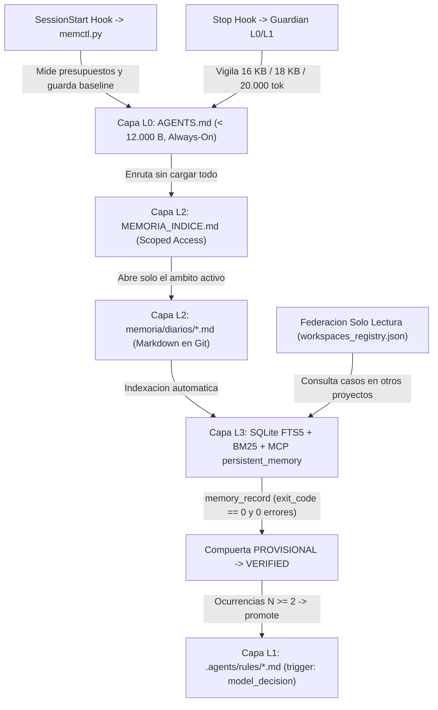

# Antigravity Persistent Memory (`L0–L3`) — Local-First Agent Memory & Case Study

> **[🌐 Portal Interactivo (GitHub Pages)](https://0utkast.github.io/antigravity-persistent-memory/)** · **[🧪 Laboratorio Visual 16:9 (*Code Spotlight*)](https://0utkast.github.io/antigravity-persistent-memory/visualizador_memoria_persistente_antigravity.html)** · **[📄 Guía Editorial PDF (A4)](https://0utkast.github.io/antigravity-persistent-memory/tutorial_memoria_persistente_antigravity.pdf)** · **[📘 Tutorial Completo (`.md`)](tutorial_memoria_persistente_antigravity.md)** · **[⚡ Instalación Rápida (ES)](#-instalación-en-1-comando-es)** · **[🇬🇧 English Quick Start](#-quick-start-english)**

Sistema completo, portable y sin dependencias externas (Python 3 estándar + `SQLite FTS5`) de **Memoria Persistente *Local-First* en 4 Capas (`L0–L3`)** para **Antigravity**. Diseñado e implantado en producción real para capturar cada descubrimiento empírico vivido con agentes de IA (creando mods complejos de *Fallout 4* y *Cyberpunk 2077* y tuberías de cursos 4K) y transformar sesiones efímeras en **agentes especialistas acumulativos**.

---

## ⚡ Instalación en 1 Comando (ES)

Instala el plugin [`plugin/persistent-memory/`](plugin/persistent-memory), registra el servidor MCP `persistent_memory` en `~/.gemini/config/mcp_config.json` (preservando tus servidores existentes con respaldo `.bak`) y configura los hooks automáticos `SessionStart` + `Stop` en Windows, macOS o Linux:

```bash
git clone https://github.com/0utKast/antigravity-persistent-memory.git
cd antigravity-persistent-memory
python install_persistent_memory.py
```

Comandos útiles tras instalar:

```bash
# Verificar servidor MCP y hooks instalados sin modificar nada
python install_persistent_memory.py --check

# Ejecutar el laboratorio real + simulación sandbox de 6 etapas
python laboratorio_memoria_persistente_antigravity.py

# Ejecutar la suite E2E portable en directorios temporales aislados
python tests/test_persistent_memory_portable.py

# Desinstalar limpiamente conservando el resto de servidores MCP
python install_persistent_memory.py --uninstall
```

> Tras instalar, reinicia Antigravity (o abre una nueva sesión) para que cargue el servidor MCP `persistent_memory` y los hooks `SessionStart` + `Stop`.

---

## 🇬🇧 Quick Start (English)

**Antigravity Persistent Memory (`L0–L3`)** solves *"Groundhog Day amnesia"* in frontier coding agents without vendor lock-in, opaque vector silos, or context bloat:

- **1-Command Cross-Platform Install (Python >= 3.10, zero pip dependencies):**
  ```bash
  git clone https://github.com/0utKast/antigravity-persistent-memory.git
  cd antigravity-persistent-memory
  python install_persistent_memory.py
  ```
- **4-Layer Architecture (`L0–L3`):**
  1. **L0 (`AGENTS.md` / global `GEMINI.md`):** Compact *Always-On* constitution kept well below Antigravity's `24,000`-byte hard truncation cap and `20,000`-token `Always-On` aggregate budget.
  2. **L1 (`.agents/rules/*.md` with `trigger: model_decision`):** Subdomain rules loaded on demand (~30 tokens at rest, `<= 18,000` bytes).
  3. **L2 (`memoria/MEMORIA_INDICE.md` + `memoria/diarios/*.md`):** Human-readable, Git-versioned Markdown *Escape Hatch* achieving `87.0%–90.3%` fixed context savings via *Scoped Access*.
  4. **L3 (`SQLite FTS5 + BM25` + `persistent_memory` MCP + `Stop` Guard):** Safe Unicode query sanitization, read-only cross-project federation, anti-Memory Poisoning gate (`PROVISIONAL -> VERIFIED`), $N \ge 2$ autonomous rule promotion, `@[label](path)` expansion auditing, and loop-safe `Stop` budget enforcement.

---

## 🧠 Arquitectura en 4 Capas (`L0–L3`)



### Las 5 Herramientas del Servidor MCP `persistent_memory`

| Herramienta MCP | Propósito | Garantía Integrada |
| :--- | :--- | :--- |
| **`memory_init`** | Inicializa `AGENTS.md`, `.agents/rules/`, `MEMORIA_INDICE.md`, diarios por stack y caché FTS5. | Autodetección de stack y registro para consulta federada. |
| **`memory_search`** | Búsqueda local o federada (solo lectura) vía `SQLite FTS5 + BM25`. | Sanitiza tokens como `Papyrus.0.log`, `FO4-EP-001` o `TweakDB:SetFlat`. |
| **`memory_record`** | Registra episodios en Markdown exigiendo **Trampa Semántica** y **Provenance**. | Bloquea con `REJECTED_MEMORY_POISONING` si `exit_code != 0` o hay errores en log. |
| **`memory_lifecycle`** | Gestiona `verify`, `recurrence`, `promote` ($N \ge 2$) y `supersede`. | Impide promover entradas `PROVISIONAL` o reglas L1 que superen `18.000 B`. |
| **`memory_audit`** | Audita bytes efectivos (incluidos `@[label](ruta)`), reglas globales y presupuesto `Always-On`. | Vigila `24.000 B` por archivo y `20.000 tokens` agregados. |

---

## 📦 Contenido del Repositorio y Entregables del Videotutorial

| Ruta / Archivo | Descripción |
| :--- | :--- |
| [`install_persistent_memory.py`](install_persistent_memory.py) | Instalador multiplataforma en 1 comando (`--check`, `--uninstall`, `--gemini-home`). |
| [`plugin/persistent-memory/`](plugin/persistent-memory) | Paquete completo del plugin (`memctl.py`, `memory_mcp_server.py`, `hooks.template.json`, regla L0 y skill `memory-steward`). |
| [`tests/test_persistent_memory_portable.py`](tests/test_persistent_memory_portable.py) | Suite E2E portable (instalación aislada, MCP JSON-RPC, FTS5, federación, `@includes` y guardián `Stop`). |
| [`plantillas_referencia/`](plantillas_referencia) | 5 plantillas limpias (`plugin.json`, `hooks.json`, `AGENTS_constitucion_L0.md`, regla L1 `model_decision`, índice L2). |
| [`laboratorio_memoria_persistente_antigravity.py`](laboratorio_memoria_persistente_antigravity.py) | Laboratorio ejecutable + simulador de 6 etapas y telemetría en [`telemetria_real_memoria_antigravity.json`](telemetria_real_memoria_antigravity.json). |
| [`tutorial_memoria_persistente_antigravity.md`](tutorial_memoria_persistente_antigravity.md) | Tutorial técnico maestro con casos empíricos reales (*Fallout 4*, *Cyberpunk 2077*, *Camtasia 4K*, *ElevenLabs*) y 13 fuentes de O'Reilly MCP. |
| [`visualizador_memoria_persistente_antigravity.html`](visualizador_memoria_persistente_antigravity.html) | Laboratorio interactivo 16:9 (*Code Spotlight* + simulador en vivo) publicado en GitHub Pages. |
| [`tutorial_memoria_persistente_antigravity.typ`](tutorial_memoria_persistente_antigravity.typ) / [`.pdf`](tutorial_memoria_persistente_antigravity.pdf) | Edición editorial maquetada en Typst (3 páginas A4). |
| [`guion_narrativo_...txt`](guion_narrativo_memoria_persistente_antigravity.txt), [`texto_diapositivas_...txt`](texto_diapositivas_memoria_persistente_antigravity.txt), [`locucion_elevenlabs_...txt`](locucion_elevenlabs_memoria_persistente_antigravity.txt) | Guion cronometrado (~18 min) + versión fiel para diapositivas + versión fonética para ElevenLabs. |
| [`YOUTUBE_TITULO_Y_DESCRIPCION.md`](YOUTUBE_TITULO_Y_DESCRIPCION.md) | Título, marcadores de tiempo y descripción validada para YouTube Studio. |

---

## 📄 Licencia Abierta (`MIT + CC BY 4.0`)

Publicado por **Jesús Conde (`0utKast`)** bajo [`LICENSE`](LICENSE):
- **Código, plugin, servidor MCP, hooks y scripts:** Licencia **MIT**.
- **Tutoriales, PDFs editoriales, guiones y laboratorio interactivo HTML:** Licencia **Creative Commons Attribution 4.0 (`CC BY 4.0`)**.
