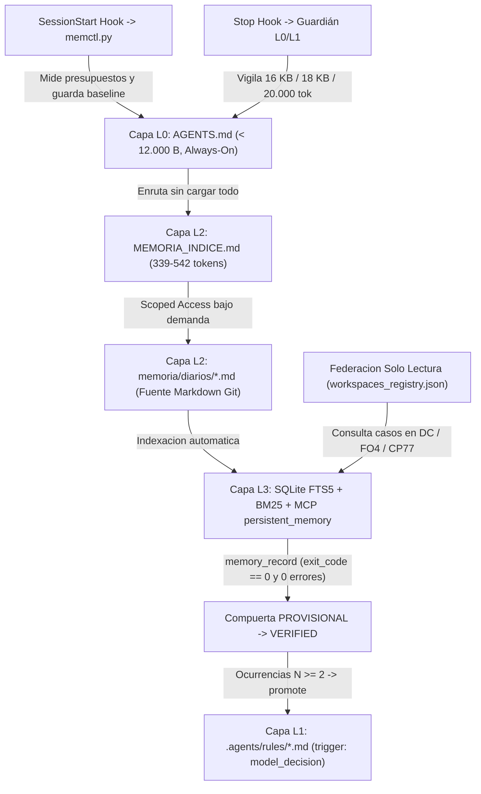

# Memoria Persistente *Local-First* en Antigravity (Capas L0–L3): Cómo Convertir la Práctica Real en Agentes Especialistas

**Categoría:** *Ingeniería de Contexto, Sistemas Agénticos y Producción Práctica en Antigravity*  
**Laboratorio Ejecutable:** [laboratorio_memoria_persistente_antigravity.py](laboratorio_memoria_persistente_antigravity.py) · [telemetria_real_memoria_antigravity.json](telemetria_real_memoria_antigravity.json)  
**Visualizador Interactivo (*Code Spotlight*):** [visualizador_memoria_persistente_antigravity.html](visualizador_memoria_persistente_antigravity.html)  
**Edición Editorial PDF:** [tutorial_memoria_persistente_antigravity.pdf](tutorial_memoria_persistente_antigravity.pdf)  
**Plugin Instalable en 1 Comando:** [install_persistent_memory.py](install_persistent_memory.py) · [memctl.py](plugin/persistent-memory/memctl.py) · [memory_mcp_server.py](plugin/persistent-memory/memory_mcp_server.py) · [hooks.template.json](plugin/persistent-memory/hooks.template.json)  
**Plantillas Transferibles:** [plantillas_referencia/](plantillas_referencia)  
**Charla Detonante (O'Reilly):** [Generative AI in the Real World: Memory for Personal AI with Duncan Davidson](https://learning.oreilly.com/videos/-/0642572475086/?orm_source=mcp) (`urn:orm:video:0642572475086`)

---

## 1. Cómo Trabajamos con Antigravity y el Choque entre Conocimiento Teórico y Realidad Empírica

En nuestro flujo diario con **Antigravity** (operando agentes basados en modelos de frontera como **Carbon**), una sola persona dirige un estudio completo de desarrollo: creamos mods ambiciosos para **Fallout 4** (*Crónicas del Refugio 13*, *Piper Wright Local Generative AI Companion*, *Project Astro-Cosmos*), mods reactivos y de diálogos para **Cyberpunk 2077** (*Ghost Echo* y *Chispa NC*) y una tubería automatizada de cursos técnicos en 4K a 60 fps.

El punto de partida siempre sorprende por su potencia: el agente domina la arquitectura teórica de motores AAA —grafos de escena, máquinas virtuales, jerarquías de esqueletos y sistemas de memoria tal como los expone **Jason Gregory** en [*Game Engine Architecture, 3rd Edition*](https://learning.oreilly.com/library/view/-/9781351974271/?orm_source=mcp)— y propone ensambladores en Python, scripts en `Papyrus`, módulos `Redscript` o parches `.esp` con velocidad asombrosa.

**Sin embargo, en cuanto bajamos a la trinchera del ejecutable real en Windows, la teoría choca contra peculiaridades empíricas que no figuran en ningún manual genérico.** Cuando el mod se compila y se prueba en partida viva, aparecen comportamientos concretos del motor y del compilador que obligan a investigar logs, hacer pruebas controladas y descartar hipótesis falsas:

| Caso Real Verificado | Qué Asumía el Modelo en Frío (Trampa Semántica) | Realidad Empírica Descubierta en Producción |
| :--- | :--- | :--- |
| **`FO4-EP-001`** (*Crónicas del Refugio 13*) | Quitar `PlayerFaction` con `Aggression = 2.0` y llamar `StartCombat(player)` hace que el escuadrón ataque al jugador. | Los miembros sin facción aliada común quedan `Neutral (0)` entre sí; `Aggression = 2.0` ordena disparar al `Neutral` más cercano y desata fratricidio en Adytum. |
| **`FO4-EP-005`** (*West Tek*) | Mover un terminal persistente (`TERM`) con `SetPosition()` actualiza su posición lógica y visual en una partida guardada. | En celdas ya serializadas en `.fos`, `SetPosition()` mueve el `NiNode` visual pero `GetPositionX()` sigue devolviendo la coordenada vieja; `OnActivate` detecta desfase y ejecuta `DisableNoWait()`, haciendo desaparecer el terminal. |
| **`FO4-EP-007` / `FO4-EP-008`** (*Fallout 4*) | `SetStage()` arranca una misión en saves antiguos; las herramientas modernas empaquetan `.ba2` compatibles y `FO4Edit` muestra 6 dígitos de `FormID`. | Una misión añadida tras crear la partida exige `Start()` explícito; `1.10.163` cierra al arranque con `.ba2 v8` (requiere `HEDR v1.0` y `.ba2 v1`); y un `.esl` (`0xFE`) reserva solo **12 bits locales** (`0x00000FFF`). |
| **`CP77-EP-004`** (*Ghost Echo / Chispa NC*) | El evento `Session/Ready` indica que `Audioware` ya cargó los bancos de voz y `Duration()` devuelve segundos exactos. | El menú dispara `Session/Ready` `~150 ms` antes de cargar los bancos, `Duration()` sin argumentos consulta `English` cortando frases en español, y el escáner Kiroshi `[TAB]` ralentiza audio con `affectedByTimeDilation = true` por defecto. |
| **`CP77-EP-002`** (*Cyberpunk 2077*) | Si una opción única de diálogo aparece en el menú nativo, su texto amarillo es legible por defecto. | Con `ArraySize(choices) == 1`, `DialogChoiceLogicController` lee `LinearWipe_0.transition == 1.00` sin animar el fondo y pinta texto negro sobre fondo oscuro. |
| **`DC-EP-001`** (*Camtasia 4K*) | Pasar `len(text)` de Python al atributo `rangeEnd` de un rótulo en `.tscproj` colorea toda la frase. | El motor C++ indexa `rangeEnd` en **bytes UTF-8 (`std::string`)**; cada raya `—` (`+2 bytes`) o tilde (`+1 byte`) deja las letras finales negras o invisibles. |

Investigar uno solo de estos fallos hasta aislar la causa raíz y validarlo dentro del juego cuesta tiempo real de compilación, reinicios de partida y miles de tokens. **Si esa investigación se queda encerrada en el historial efímero de un chat, al abrir una nueva sesión el agente sufre amnesia operativa y vuelve a caer en la misma trampa.**

$$C_{\text{sin\_memoria}} = \sum_{s=1}^{M} \left( T_{\text{razonamiento}} + k_{\text{reintentos}} \cdot T_{\text{error\_y\_log}} \right) \gg C_{\text{L0–L3}} = T_{\text{índice}} + T_{\text{búsqueda\_bm25}} + T_{\text{Pass@1}}$$

> [!IMPORTANT]
> Cada fallo real depurado hasta dejar el compilador y el juego en verde no es un accidente que haya que olvidar tras el parche: es **conocimiento empírico de alto valor** que, capturado con rigor, transforma con el tiempo a un agente generalista en un auténtico especialista veterano de tu código y de tus motores.

---

## 2. El Límite Oculto Descubierto en Producción (`24.000 Bytes` y `20.000 Tokens`) y los Principios de Duncan Davidson

Al principio intentamos resolver este problema a fuerza bruta: anotando cada lección directamente en un `AGENTS.md` único y en un diario plano creciente (`DIARIO_TECNICO_MODDING_FALLOUT.md`). Esa primera aproximación funcionó durante unas semanas hasta chocar con dos límites reales de arquitectura documentados en las guías internas de reglas de Antigravity (`agy-customizations/docs/rules.md`):

1. **Tope duro de `24.000 bytes` por archivo de regla:** Al alcanzar los `24.000 bytes` (incluidos anexos referenciados con `@[label](ruta)`), el sistema trunca el archivo por líneas de forma silenciosa. En nuestro repositorio `Mods_Fallout`, `AGENTS.md` llegó a **`23.585 bytes`** (**`98,3 %`** del límite) y el diario monolítico alcanzó **`18.494 bytes`**. Estábamos a un solo párrafo de perder reglas críticas del final del archivo.
2. **Presupuesto agregado `Always-On` de `20.000 tokens` (`defaultRulesBudget`):** Todas las reglas globales y de carga incondicional compiten por un techo conjunto de `20.000 tokens`; superarlo degrada reglas completas a simples punteros de ruta. En nuestra propia estación descubrimos que `GEMINI.md` global acumulaba `5.321 bytes` de recuerdos antiguos y duplicados de proyectos pasados que se inyectaban en todas las conversaciones.

La salida técnica la encontramos cruzando la charla [**Memory for Personal AI with Duncan Davidson**](https://learning.oreilly.com/videos/-/0642572475086/?orm_source=mcp) (`urn:orm:video:0642572475086`) con el corpus de ingeniería de memoria de **O'Reilly Learning** (Benjamin Labaschin, Ksenia Se, Pete Johnson, Richmond Alake, Drew Breunig, Addy Osmani, Nicole Koenigstein, David Jambor, Firat Tekiner, Chip Huyen y Michael Albada):

* **Fin de los silos y *Local-First* (*Escape Hatch Principle*):** «Cambiar de agente no debería significar mudarse de casa» (Duncan Davidson). La fuente de verdad canónica vive en archivos **Markdown versionados en Git** junto al código del proyecto, legible por humanos y auditable con `git diff`, sin depender de nubes propietarias ni bases vectoriales opacas.
* **Acceso por ámbitos (*Scoped Access*):** No todo el historial entra en la ventana de trabajo (evitando *Context Rot*, Drew Breunig). Un índice ligero y búsquedas selectivas exponen únicamente los episodios del subsistema activo.
* **Taxonomía en 4 memorias + Defensa anti-envenenamiento (*Memory Poisoning*):** Como advierten Ksenia Se y Pete Johnson en [*Expert Showcase: Agent Memory*](https://learning.oreilly.com/videos/-/0642572428136/?orm_source=mcp), guardar conjeturas no probadas infecta todas las sesiones futuras. Cada aprendizaje exige compuerta determinista, **Trampa Semántica** y **Provenance** antes de madurar hacia reglas permanentes.

---

## 3. Arquitectura Real en 4 Capas (`L0–L3`) e Integración Nativa en Antigravity

En lugar de un documento único que crece sin control, nuestro plugin global [persistent-memory](plugin/persistent-memory/plugin.json) despliega en cada proyecto una arquitectura soberana en cuatro capas conectada directamente al ciclo de vida de Antigravity mediante `hooks.json` y el servidor MCP `persistent_memory`:

| Capa | Artefacto en Disco | Comportamiento en Antigravity | Presupuesto y Regla de Oro |
| :--- | :--- | :--- | :--- |
| **L0 — Constitución** | `AGENTS.md` + `GEMINI.md` global | Se inyecta siempre al inicio de sesión (*Always-On*). | Mantener `< 12.000 B` (alerta `>= 16.000 B`, tope duro `24.000 B`). Solo leyes nucleares y enlace al índice. |
| **L1 — Procedimental Modular** | `.agents/rules/*.md` (`trigger: model_decision`) y `SKILL.md` | Carga progresiva bajo demanda (~30 tokens en reposo por descripción). | Máximo `18.000 B` efectivos por archivo. Aquí ascienden las reglas cuando $N \ge 2$. |
| **L2 — Memoria Episódica** | `memoria/MEMORIA_INDICE.md` y `memoria/diarios/<ambito>.md` | Única Fuente de Verdad legible por humanos y versionable en Git (*Escape Hatch*). | Ahorro fijo de contexto del **`87,0 %` al `90,3 %`** frente a cargar los diarios completos. |
| **L3 — Índice y Federación MCP** | `memoria/.cache/memoria_fts.sqlite` + `memory_mcp_server.py` | Búsqueda local `FTS5/BM25` y consulta federada de solo lectura entre proyectos. | Caché efímera ignorada por Git (`.gitignore`), regenerada automáticamente si cambian los `.md`. |

> [!TIP]
> El servidor [memory_mcp_server.py](plugin/persistent-memory/memory_mcp_server.py) expone exactamente cinco herramientas limpias (`memory_init`, `memory_search`, `memory_record`, `memory_lifecycle` y `memory_audit`) sobre protocolo JSON-RPC `stdio`, registradas globalmente para que cualquier nuevo espacio de trabajo herede esta infraestructura desde el minuto uno.

---

## 4. Anatomía Técnica del Motor: De la Trampa Semántica al Guardián `Stop`

El corazón técnico del sistema vive en [memctl.py](plugin/persistent-memory/memctl.py) (Python 3 estándar, cero dependencias externas) y en nuestro laboratorio verificable [laboratorio_memoria_persistente_antigravity.py](laboratorio_memoria_persistente_antigravity.py). Estas son sus cinco piezas deterministas clave:

1. **Tokenización segura en `SQLite FTS5 + BM25` ([sanitize_fts_terms](plugin/persistent-memory/memctl.py#L950-L963) y [search_memory](plugin/persistent-memory/memctl.py#L966-L1058)):**
   En nuestros diarios abundan identificadores con puntos, guiones o dos puntos (`Papyrus.0.log`, `FO4-EP-001`, `TweakDB:SetFlat`, `LinearWipe_0`, `0x00000FFF`) que rompen la sintaxis estándar de `MATCH` si se pasan crudos. `sanitize_fts_terms()` extrae tokens `\w+` Unicode, descarta ruido de un carácter como el `0` de `Papyrus.0.log`, envuelve cada término entre comillas dobles en consultas `AND` con degradación controlada a `OR`, usa el tokenizador `unicode61 remove_diacritics 2` (insensible a tildes) y pondera título, síntoma, causa raíz y solución con `bm25(...)`.
2. **El campo obligatorio *Trampa Semántica*:**
   Documentar solo «qué funcionó» deja al agente vulnerable a volver a intentar su primera intuición errónea. Cada entrada episódica registra obligatoriamente **`Trampa Semántica (Hipótesis Descartadas)`** (por ejemplo, *"tomar los 6 dígitos bajos `0x00FFFFFF` en `FO4Edit`"* o *"subir `Similarity Boost` al `95 %` en inglés"*), **`Causa Raíz`**, **`Solución Determinista`** y **`Evidencia de Verificación (Provenance)`**.
3. **Compuerta Anti-Envenenamiento y ciclo `PROVISIONAL -> VERIFIED` ([record_memory](plugin/persistent-memory/memctl.py#L1073-L1168) y [lifecycle_action](plugin/persistent-memory/memctl.py#L1194-L1362)):**
   Si el compilador devolvió `exit_code != 0`, hay cadenas en `log_errors` o falta explicación suficiente de causa raíz/procedencia, `record_memory()` devuelve `REJECTED_MEMORY_POISONING`. Cuando compila en verde pero falta prueba en vivo dentro del juego o vídeo, el hallazgo nace en estado **`PROVISIONAL`**; el sistema prohíbe promoverlo a regla L1 (`REJECTED_PROMOTION`) hasta confirmar en ejecución real (`verify`) y acumular recurrencia **`N >= 2`** (`promote`).
4. **Auditoría profunda con expansión `@[label](ruta)` y presupuesto `Always-On` ([expand_rule_includes](plugin/persistent-memory/memctl.py#L226-L253) y [audit_global_rules](plugin/persistent-memory/memctl.py#L287-L353)):**
   Antigravity calcula el límite de `24.000 bytes` después de expandir inclusiones `@[label](ruta)` y suma todas las reglas incondicionales dentro de los `20.000 tokens`. Nuestro auditor expande inclusiones hasta profundidad 3, lee los `frontmatter` para distinguir `always_on` de `model_decision`, recorre subdirectorios del proyecto y contabiliza las reglas globales y de plugins habilitados.
5. **Vigilancia automática sin interferencia (`SessionStart` + `Stop` en [hooks.template.json](plugin/persistent-memory/hooks.template.json)):**
   ¿Por qué diseñamos un guardián en el evento `Stop` (`handle_stop`) en lugar de bloquear `write_file` en `PreToolUse`? Porque interceptar `PreToolUse` obliga a devolver decisiones de permiso (`allow`/`ask`/`deny`) que podrían alterar las comprobaciones nativas de seguridad del entorno, mientras que `Stop` se ejecuta una sola vez al cierre del turno y detecta crecimientos reales sin importar si vinieron de edición directa o de un script. Al arrancar la sesión ([handle_session_start](plugin/persistent-memory/memctl.py#L1559-L1636)), se guarda una línea base de tamaños; si al cerrar el turno una regla modificada cruza `>= 16.000 B` (`AGENTS.md`/`GEMINI.md`), `> 18.000 B` (reglas L1) o `>= 18.500 tokens` `Always-On`, `handle_stop` solicita una auto-refactorización antes de parar (`decision: "continue"`), protegido siempre por el flag `continuationActive` para impedir bucles infinitos.

> [!WARNING]
> **Lección práctica de Windows en producción (`test_03`):** Al probar el hook `SessionStart` con carpetas temporales creadas por Python (`tempfile.mkdtemp`), el filtro protector que excluye carpetas del sistema bajo `AppData` bloqueó inicialmente las pruebas en `AppData\Local\Temp`. Eximir explícitamente `Local\Temp` en [is_ignored_hook_path](plugin/persistent-memory/memctl.py#L1543-L1556) permite validar todo el ciclo de hooks de forma aislada y determinista.

---

## 5. Telemetría Real de Producción en Nuestros 3 Proyectos + Simulación

Al ejecutar [laboratorio_memoria_persistente_antigravity.py](laboratorio_memoria_persistente_antigravity.py), el sistema audita en vivo nuestros tres espacios de trabajo registrados y simula el ciclo completo de seis etapas en un proyecto aislado, consolidando las cifras en [telemetria_real_memoria_antigravity.json](telemetria_real_memoria_antigravity.json):

### 5.1. Rescate Real y Salud Actual de Nuestra Estación (`Bloque A`)

| Espacio de Trabajo / Regla Global | Antes del Sistema (`AGENTS`/`GEMINI`) | Estado Actual (`Bytes` / `%` de `24 KB`) | Reglas L1 (`model_decision`) | Presupuesto `Always-On` (`20.000 tok`) | Ahorro Índice (`MEMORIA_INDICE.md`) | Entradas `VERIFIED` |
| :--- | :---: | :---: | :---: | :---: | :---: | :---: |
| **`GEMINI.md` global** | `5.321 B` (ruido acumulado) | **`1.364 B`** (`5,7 %`, `-74,4 %`) | `1` global (`camtasia-produccion`) | `1.117 tok` globales (`5,6 %`) | N/A | N/A |
| **`Mods_Fallout` (`FO4`)** | **`23.585 B`** (**`98,3 %`**, al borde de truncado) | **`5.071 B`** (`21,1 %`, **`-78,5 %`**) | `4` archivos | `3.557 / 20.000 tok` (`17,8 %`) | `390` vs `3.323 tok` (**`88,3 %`**) | **`8`** |
| **`Mods_cyberpunk2077` (`CP77`)** | Histórico sin indexar | **`6.525 B`** (`27,2 %`, `OK`) | `2` archivos | `2.749 / 20.000 tok` (`13,7 %`) | `542` vs `5.597 tok` (**`90,3 %`**) | **`14`** |
| **`DesarrolloCursos` (`DC`)** | Reglas dispersas entre proyectos | **`3.860 B`** (`16,1 %`, `OK`) | `3` archivos | `2.082 / 20.000 tok` (`10,4 %`) | `339` vs `2.612 tok` (**`87,0 %`**) | **`7`** |

### 5.2. Consultas Federadas Reales (`SQLite FTS5 + BM25`) y Simulación de Especialización (`Bloque B`)

| Experimento Verificado | Resultado Empírico Medido | Evidencia en Telemetría JSON |
| :--- | :--- | :--- |
| **Búsqueda federada `Mods_Fallout`** | `FO4-EP-001` (`-11.8836`), `FO4-EP-005` (`-10.8962`), `FO4-EP-008` (`-14.708`) | `block_a_real_station.federated_fts5_queries` |
| **Búsqueda federada `Mods_cyberpunk2077`** | `CP77-EP-002` (`-8.6314`), `CP77-EP-004` (`-12.1194`) | `block_a_real_station.federated_fts5_queries` |
| **Búsqueda local `DesarrolloCursos`** | `DC-EP-001` (`-6.5165`), `DC-EP-004` (`-8.1331`) | `block_a_real_station.federated_fts5_queries` |
| **Agente en frío vs `Pass@1` (sandbox)** | De `5 turnos / 9.240 tokens` a **`1 turno / 1.120 tokens`** (**`87,9 %` de ahorro**) | `block_b_sandbox_lifecycle.stage_2_cold_vs_warm_benchmark` |
| **Compuerta anti-envenenamiento** | Bloqueo `REJECTED_MEMORY_POISONING` ante `exit_code=1` y error en log | `block_b_sandbox_lifecycle.stage_3_anti_poisoning_gate` |
| **Maduración y ascenso `N >= 2` a L1** | `MLD-EP-001` pasa `PROVISIONAL` -> `VERIFIED` -> `MLD-INV-01` (`790 B` en L1, `AGENTS.md` intacto en `936 B`) | `block_b_sandbox_lifecycle.stage_5_l1_promotion_n_ge_2` |
| **Inclusiones y guardián `Stop`** | `@[anexo]` de `114 B` medido en `18.317 B` (`WARNING`); `AGENTS.md` inflado (`19.088 B`) dispara `decision: "continue"` y `continuationActive=True` corta el bucle (`"stop"`) | `block_b_sandbox_lifecycle.stage_6_include_and_stop_guard` |

---

## 6. Cápsula de Transferencia Universal: Del Modding a Cualquier Proyecto de Software

El mismo arnés de cuatro capas que convierte a un agente en especialista en *Creation Engine* o *REDengine 4* es transferible de inmediato a cualquier otro dominio técnico gracias a su autodetección de perfiles en [detect_project_profile](plugin/persistent-memory/memctl.py#L480-L545):

| Pilar del Sistema | En Nuestra Estación de Modding y Cursos 4K | En Motores Comerciales y Software General |
| :--- | :--- | :--- |
| **Capa L0 compacta (`< 12 KB`)** | Leyes universales de compatibilidad `.esp`/`.ba2`, composición `@wrapMethod` o reglas de audio 4K. | Contratos de API, convenciones de seguridad, arquitectura de microservicios y presupuesto de contexto. |
| **Capa L1 (`model_decision`)** | Reglas modulares para `Nexus Mods`, `Audioware`, `Camtasia` o `ElevenLabs`. | Guías condicionales para `Kubernetes`, migraciones `PostgreSQL`, `Rust FFI` o shaders `WebGPU`. |
| **Capa L2 (`diarios/` en Git)** | Bitácoras verificadas por ámbito con **Trampa Semántica** y log exacto del motor. | *Post-mortems* técnicos y *ADRs* vivos junto al código en `Git` con trazabilidad `git blame`. |
| **Capa L3 (Compuerta + `FTS5` + `Stop`)** | Exige `PapyrusCompiler`, `redscript-cli`, `typst` o `pytest` en `0` errores antes de consolidar. | Exige `cargo test`, `tsc --noEmit` o suites CI en verde y vigila la salud de los archivos de reglas al final de cada turno. |

---

## 7. Citas de Autoridad y Bibliografía Oficial O'Reilly (`MCP`)

> *«Cada herramienta de IA recuerda hoy una versión distinta y aislada de nosotros; la única salida sostenible es un hogar local-first de contexto propiedad del usuario, portable en archivos Markdown y expuesto por ámbitos bajo permisos explícitos.»* — **Duncan Davidson** ([*Memory for Personal AI*](https://learning.oreilly.com/videos/-/0642572475086/?orm_source=mcp))

> *«Sin mecanismos estrictos de validación y olvido selectivo durante la consolidación, la memoria persistente se convierte en un amplificador de errores conocido como envenenamiento de memoria.»* — **Ksenia Se & Pete Johnson** ([*Expert Showcase: Agent Memory*](https://learning.oreilly.com/videos/-/0642572428136/?orm_source=mcp))

1. **Lorica, Ben; Davidson, Duncan (2026-11-12).** *Generative AI in the Real World: Memory for Personal AI with Duncan Davidson*. O'Reilly Media, Inc. (`video`, `urn:orm:video:0642572475086`).
   * **Justificación de lectura:** Charla troncal que define el diseño *Local-First*, el principio *Escape Hatch* en Markdown, los ámbitos de confianza (*Scoped Access*) y la negociación con procedencia.
   * **Enlace oficial O'Reilly:** [Memory for Personal AI with Duncan Davidson](https://learning.oreilly.com/videos/-/0642572475086/?orm_source=mcp)
2. **Labaschin, Benjamin (2027 — *Early Release*).** *Agent Memory*. O'Reilly Media, Inc. (`book`, `300 pp.`, `urn:orm:book:0642572370473`).
   * **Justificación de lectura:** Tratado completo sobre almacenamiento, recuperación, actualización y ciclo de vida de la memoria en agentes autónomos.
   * **Enlace oficial O'Reilly:** [Agent Memory](https://learning.oreilly.com/library/view/-/0642572370473/?orm_source=mcp)
3. **Labaschin, Benjamin; Wallace, Jim Allen; Brookins, Andrew; Singh, Manvinder (2025-10-25).** *Managing Memory for AI Agents*. O'Reilly Media, Inc. (`book`, `54 pp.`, `urn:orm:book:9798341661257`).
   * **Justificación de lectura:** Formaliza la taxonomía en cuatro memorias (de trabajo, semántica, episódica y procedimental) que estructura nuestras capas L0–L3.
   * **Enlace oficial O'Reilly:** [Managing Memory for AI Agents](https://learning.oreilly.com/library/view/-/9798341661257/?orm_source=mcp)
4. **Se, Ksenia; Liu, Lewis; Johnson, Pete et al. (2026-10-13).** *Expert Showcase: Agent Memory*. O'Reilly Media, Inc. (`video`, `3h 11m`, `urn:orm:video:0642572428136`).
   * **Justificación de lectura:** Profundiza en la prevención del envenenamiento de memoria (*Memory Poisoning*), consolidación verificada y poda de reglas obsoletas.
   * **Enlace oficial O'Reilly:** [Expert Showcase: Agent Memory](https://learning.oreilly.com/videos/-/0642572428136/?orm_source=mcp)
5. **Alake, Richmond (2026).** *Build Self-Improving Agents with Memory, Traces, and Skills*. O'Reilly Media, Inc. (`live-event-series`, `urn:orm:live-event-series:0642572457082`).
   * **Justificación de lectura:** Describe el bucle práctico desde trazas reales de ejecución hasta memoria episódica y ascenso hacia habilidades y reglas reutilizables (`SKILL.md`).
   * **Enlace oficial O'Reilly:** [Build Self-Improving Agents with Memory, Traces, and Skills](https://learning.oreilly.com/live-events/-/0642572457082/?orm_source=mcp)
6. **Osmani, Addy (2027 — *Early Release*).** *Agentic Engineering*. O'Reilly Media, Inc. (`book`, `350 pp.`, `urn:orm:book:0642572392291`).
   * **Justificación de lectura:** Guía aplicada para diseñar constituciones `AGENTS.md` efectivas y ciclos de verificación determinista en repositorios vivos.
   * **Enlace oficial O'Reilly:** [Agentic Engineering](https://learning.oreilly.com/library/view/-/0642572392291/?orm_source=mcp)
7. **Koenigstein, Nicole (2027 — *Early Release*).** *Harness Engineering*. O'Reilly Media, Inc. (`book`, `350 pp.`, `urn:orm:book:0642572422783`).
   * **Justificación de lectura:** Desarrolla la arquitectura de arneses ligeros (*Thin Harnesses*), *hooks* de ciclo de vida y compuertas de fiabilidad sobre la ejecución de agentes.
   * **Enlace oficial O'Reilly:** [Harness Engineering](https://learning.oreilly.com/library/view/-/0642572422783/?orm_source=mcp)
8. **Breunig, Drew (2027 — *Early Release*).** *The Context Engineering Handbook*. O'Reilly Media, Inc. (`book`, `225 pp.`, `urn:orm:book:0642572260705`).
   * **Justificación de lectura:** Explica el fenómeno de degradación de atención (*Context Rot*) y cómo combatirlo mediante presupuesto de tokens y divulgación progresiva.
   * **Enlace oficial O'Reilly:** [The Context Engineering Handbook](https://learning.oreilly.com/library/view/-/0642572260705/?orm_source=mcp)
9. **Jambor, David (2026-11-16).** *Agentic Reliability Engineering*. O'Reilly Media, Inc. (`book`, `429 pp.`, `urn:orm:book:0642572294809`).
   * **Justificación de lectura:** Establece criterios deterministas de fiabilidad y pruebas automatizadas de regresión para validar sistemas agénticos en producción.
   * **Enlace oficial O'Reilly:** [Agentic Reliability Engineering](https://learning.oreilly.com/library/view/-/0642572294809/?orm_source=mcp)
10. **Tekiner, Firat (2027 — *Early Release*).** *Architecting Data Systems for AI Agents*. O'Reilly Media, Inc. (`book`, `300 pp.`, `urn:orm:book:0642572354664`).
    * **Justificación de lectura:** Analiza trazabilidad de procedencia (*provenance*), indexación y almacenamiento persistente para recuperar hechos fiables.
    * **Enlace oficial O'Reilly:** [Architecting Data Systems for AI Agents](https://learning.oreilly.com/library/view/-/0642572354664/?orm_source=mcp)
11. **Gregory, Jason (2018).** *Game Engine Architecture, 3rd Edition*. A K Peters/CRC Press (`book`, `1240 pp.`, `urn:orm:book:9781351974271`).
    * **Justificación de lectura:** Referencia clásica sobre arquitectura interna de motores comerciales, base teórica de los modelos que debe complementarse con la experiencia empírica de cada motor real.
    * **Enlace oficial O'Reilly:** [Game Engine Architecture, 3rd Edition](https://learning.oreilly.com/library/view/-/9781351974271/?orm_source=mcp)
12. **Huyen, Chip (2024-12-04).** *AI Engineering*. O'Reilly Media, Inc. (`book`, `534 pp.`, `urn:orm:book:9781098166298`).
    * **Justificación de lectura:** Marco integral de ingeniería aplicada para evaluar, adaptar y poner en producción aplicaciones basadas en modelos fundacionales.
    * **Enlace oficial O'Reilly:** [AI Engineering](https://learning.oreilly.com/library/view/-/9781098166298/?orm_source=mcp)
13. **Albada, Michael (2025-09-17).** *Building Applications with AI Agents*. O'Reilly Media, Inc. (`book`, `354 pp.`, `urn:orm:book:9781098176495`).
    * **Justificación de lectura:** Patrones de diseño para dotar a agentes autónomos de herramientas, estado persistente y coordinación multi-turno fiable.
    * **Enlace oficial O'Reilly:** [Building Applications with AI Agents](https://learning.oreilly.com/library/view/-/9781098176495/?orm_source=mcp)
